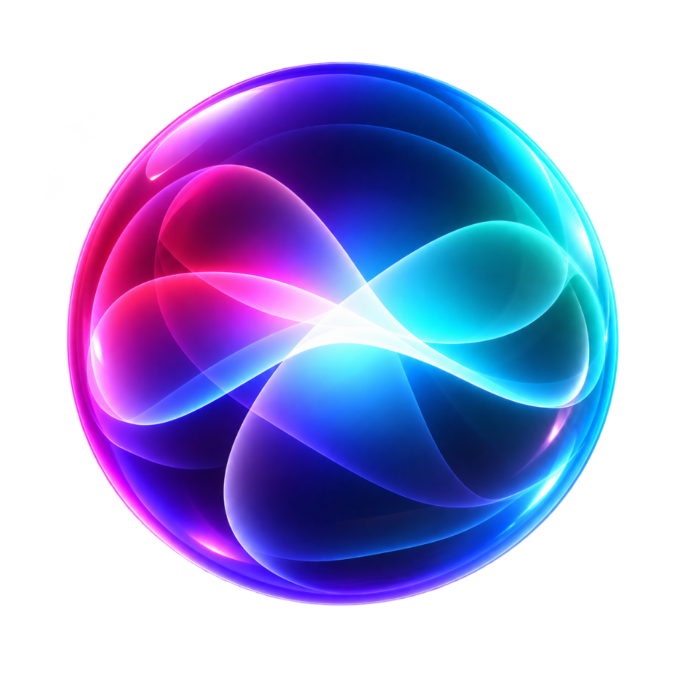

# 🏝️ Dynamic Island for Windows

<p align="center">
  
</p>

<p align="center">
  <b>Bring the fluid, elegant Apple iPhone Dynamic Island experience to your Windows desktop.</b>
</p>

<p align="center">
  
  
  
  
  
</p>

---

## ✨ Overview

**Dynamic Island for Windows** is an ultra-fluid, non-intrusive floating pill pinned seamlessly to the top of your screen. Built with **Electron**, **GSAP**, and native Windows APIs, it delivers smooth morphing live activities for your media playback, system monitoring, utility shortcuts, and notifications—without getting in your way.

---

## 🚀 Key Features

### 🎵 1. Live Media Player & Hardware Controls
- **Global Media Detection**: Works out-of-the-box with Spotify, Apple Music, YouTube (Chrome/Edge), Tidal, VLC, and Windows Media Session.
- **Dynamic Equalizer**: Real-time dancing audio visualizer waveform.
- **Interactive Scrubber**: Click or drag across the seek bar to jump directly to any second in a track.
- **Hardware Controls**: Previous Track, 10s Rewind, Play/Pause, 10s Fast-Forward, Next Track.
- **Album Artwork & Glare**: High-resolution thumbnail extraction with realistic iOS gloss and reflection effects.

### ⚡ 2. System Quick Actions Hub
Expand the island to instantly access customized macOS/iOS squircle app tiles:
- **YouTube**: 1-click browser launch.
- **Snip**: Direct shortcut to the Windows Snipping Tool (`ms-screenclip:`).
- **Calculator**: Fast access to Windows Calc (`calc.exe`).
- **Files**: One-tap shortcut to File Explorer.
- **Lock**: Instant Windows lock workstation (`LockWorkStation`).
- **Power Menu**: Integrated in-island confirmation panel for **Shut Down**, **Sleep**, and **Restart**.

### 🔋 3. Battery & System Monitor
- Real-time battery percentage tracking.
- Charging animation with dynamic gradient fill.
- Automatic power state alerts.

### ⏱️ 4. Stopwatch & Timer
- Animated circular SVG progress countdown ring.
- Start, pause, and reset actions directly from the island.
- Audio / notification completion alerts.

### 🎨 5. Appearance Customization & Settings Window
- **Live Preview Pill**: Real-time visual feedback as you tweak sliders.
- **Preset Themes**:
  - 🌌 **Void Black**: Pitch-black minimalist styling.
  - 🪟 **Glass**: Frosted glassmorphism with dynamic background blur.
  - 🌫️ **Smoke**: Deep grey moody tint.
  - 🖤 **AMOLED**: True OLED black with maximum contrast.
- **Granular Controls**:
  - Background Opacity & Blur Amount (0px - 60px).
  - Saturation & Brightness multipliers.
  - Tint Color Swatches + **Custom Hex Color Picker** + Intensity slider.
  - Border Opacity, Drop Shadow Intensity, and Inner Glow.
  - Auto-collapse delay timer.
- **Persistent Storage**:
  - Dedicated **Save Changes** button with live status feedback.
  - Settings are saved permanently to `%APPDATA%\dynamic-island-windows\island-settings.json` and sync across reboots.
  - **Reset to Defaults** button to restore factory glass settings anytime.

### 🖥️ 6. Seamless Desktop Integration
- **Click-Through Transparency**: Mouse events pass straight through the transparent canvas when collapsed.
- **Always on Top**: Kept at the highest OS window level (`screen-saver` layer) without DWM flickering.
- **System Tray Menu**: Right-click the system tray icon to Show/Hide, open Settings, enable **Run on Windows Boot**, or Quit.

---

## 📦 Installation & Setup

### Prerequisites
- Windows 10 or Windows 11 (64-bit)
- [Node.js](https://nodejs.org/) (v18.x or v20.x recommended)
- Git

### 1. Clone the Repository
```bash
git clone https://github.com/yashk40/Dynamic-island.git
cd Dynamic-island
```

### 2. Install Dependencies
```bash
npm install
```

### 3. Run the App
```bash
npm start
```

Or run in development mode with developer tools:
```bash
npm run dev
```

---

## ⚙️ Start on Windows Boot (Autostart)

To enable Dynamic Island to start automatically when your PC boots up:

**Via UI:**
- Right-click the **Dynamic Island** pill icon in the Windows Taskbar System Tray.
- Check **"Start on Windows Boot"**.

**Via Command Line:**
```bash
# Enable autostart
npm run autostart:enable

# Disable autostart
npm run autostart:disable
```

---

## 🛠️ Project Structure

```
Dynamic-island/
├── assets/
│   └── tray-icon.png          # System tray icon
├── renderer/
│   ├── index.html             # Island canvas & UI states
│   ├── island.css             # Glassmorphism design & animations
│   ├── island.js              # State manager & GSAP animations
│   └── settings.html          # Appearance Customizer with Live Preview
├── scripts/
│   └── autostart.js           # Windows Startup shortcut generator
├── services/
│   ├── battery.js             # Battery & power tracking
│   ├── media.js               # Windows Media Session & Now Playing extractor
│   ├── mediaController.js     # Media key dispatcher (Play/Pause/Skip/Seek)
│   └── network.js             # Network status monitor
├── main.js                    # Electron main process & IPC coordinator
├── preload.js                 # Secure context bridge
├── package.json
└── README.md
```

---

## 🎛️ Customization Guide

1. Open the System Tray and click **Appearance Settings...**.
2. Customize your sliders:
   - Adjust **Background Opacity** and **Blur Amount** for the perfect frosted glass look.
   - Pick a custom **Tint Color** to match your desktop wallpaper.
   - Adjust the **Auto-collapse delay** for how long the island stays expanded after mouse hover.
3. Click the vibrant **Save Changes** button at the bottom.
4. Your preferences are saved automatically and survive PC reboots!

---

## 🤝 Contributing

Contributions, feature suggestions, and bug reports are welcome!
1. Fork the Project.
2. Create your Feature Branch (`git checkout -b feature/AmazingFeature`).
3. Commit your Changes (`git commit -m 'Add some AmazingFeature'`).
4. Push to the Branch (`git push origin feature/AmazingFeature`).
5. Open a Pull Request.

---

## 📄 License

Distributed under the **MIT License**. See `LICENSE` for more information.

---

<p align="center">
  Crafted with ❤️ for Windows enthusiasts.
</p>
