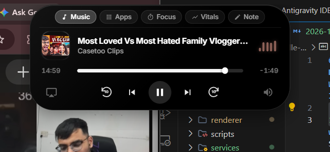

# Dynamic Island Idle Docking and Enhanced Widget Hub Implementation Plan
workers:** REQUIRED SUB-SKILL: Use superpowers:subagent-driven-development (recommended) or superpowers:executing-plans to implement this plan task-by-task. Steps use checkbox (`- [ ]`) syntax for tracking.

**Goal:** Transform the Windows Dynamic Island from a rigid, center-blocking pill into a smart auto-docking island (stealth top notch, corner orb, or auto-hide when idle) and expand it with high-value widgets (Multi-tab Island Hub with Pomodoro Focus, Live System Vitals, Quick Scratchpad, and Dock Mode controls).

**Architecture:** 
- In `main.js`: Enhance window position management and IPC channels for docking modes (`stealth-notch`, `corner-dock`, `auto-hide`, `classic-pill`), adjusting window placement and mouse tracking regions dynamically.
- In `renderer/index.html` & `island.css`: Add the stealth micro-notch idle state (6px sleek top flush bar with ambient pulse), expanded multi-tab navigation header (Media, Quick Hub, Pomodoro, Vitals, Notes), new interactive panels for Pomodoro with presets, Hardware Vitals with real-time gauges, and Persistent Scratchpad note-taker.
- In `renderer/island.js`: Enhance the state machine to support dock mode transitions, idle timers, category tab switching inside the expanded island, and persistent localStorage sync for notes and dock preferences.

**Tech Stack:** Electron 31, Node.js, GSAP 3.15, SystemInformation, Vanilla JS & CSS3 Glassmorphism

---

### Task 1: Smart Idle Docking Architecture in `main.js` and `preload.js`

**Files:**
- Modify: `main.js`
- Modify: `preload.js`

**Interfaces:**
- Produces: `bridge.setDockMode(mode)` and IPC handler `'set-dock-mode'` to dynamically re-position window coordinates (`screenW/2` center vs top-right corner or top edge flush).
- Consumes: Electron `screen.getPrimaryDisplay()`, `BrowserWindow.setPosition()`.

- [ ] **Step 1: Add dockMode state and IPC handlers in `main.js`**
  Add support for `'stealth'` (default, y=0 flush), `'corner'` (top-right, x=screenW - 240, y=8), `'autohide'` (y=-30 until hover), and `'center'` (traditional).
- [ ] **Step 2: Update cursor tracker in `main.js` to adapt to active dock mode**
  Update `startCursorTracker()` geometry calculation so mouse detection accounts for window position offsets and edge-trigger zones.
- [ ] **Step 3: Expose `setDockMode` and `getDockMode` in `preload.js`**
  Add `setDockMode` and `onDockModeChanged` to `contextBridge.exposeInMainWorld('islandBridge', ...)`.
- [ ] **Step 4: Verify syntax and Electron window positioning**
  Run: `node -c main.js` and `node -c preload.js`
  Expected: PASS with 0 syntax errors.

---

### Task 2: Stealth Idle Micro-Notch & Dock Mode Styles in `island.css`

**Files:**
- Modify: `renderer/island.css`

**Interfaces:**
- Produces: CSS classes `.island.stealth`, `.island.corner`, `.island.autohide`, and smooth morphing transitions for the unobtrusive idle state.
- Produces: Styling for the top category switcher tabs (`.island-tabs`, `.tab-item`), Pomodoro widget, System Vitals live cards, and Scratchpad notes.

- [ ] **Step 1: Define CSS rules for stealth micro-notch**
  Add `.island.stealth` (`width: 80px; height: 6px; border-radius: 0 0 8px 8px;` with subtle ambient light bar) that sits flush against the top screen bezel without covering any browser tabs.
- [ ] **Step 2: Define CSS rules for corner dock mode**
  Add `.island.corner` styling and smooth entrance animations.
- [ ] **Step 3: Design the Expanded Island Category Tab Switcher**
  Add styles for sleek horizontal pill tabs: `[ 🎵 Media | ⚡ Hub | ⏱️ Focus | 📊 Vitals | 📝 Note ]`.
- [ ] **Step 4: Design Pomodoro, System Vitals, and Quick Notes UI components**
  Add responsive glassmorphism cards, glowing progress bars, preset buttons, and auto-growing textarea for notes.
- [ ] **Step 5: Verify CSS rules**
  Validate no broken rules or syntax regressions.

---

### Task 3: Multi-Widget Markup in `renderer/index.html`

**Files:**
- Modify: `renderer/index.html`

**Interfaces:**
- Consumes: SVG icons and CSS glass tokens.
- Produces: 
  - Stealth idle ambient glow element (`#stealth-indicator`).
  - Top Island Tab Bar (`#island-tab-bar`).
  - Pomodoro Focus Card (`#focus-expanded`).
  - Live Performance Vitals Card (`#vitals-expanded`).
  - Quick Scratchpad Card (`#notes-expanded`).
  - Dock Mode Switcher toggle pills.

- [ ] **Step 1: Add stealth micro-notch idle markup to index.html**
  Add `#stealth-state` containing a subtle glowing ambient bar and tiny status dot.
- [ ] **Step 2: Insert category tab switcher into expanded container**
  Provide one-click navigation between Media, Quick Hub, Focus, Vitals, and Scratchpad.
- [ ] **Step 3: Add Pomodoro Focus expanded state**
  Include 25m Focus, 5m Break, 15m Sprint quick-start buttons, circular countdown ring, and start/reset controls.
- [ ] **Step 4: Add System Vitals expanded state**
  Include animated CPU %, RAM %, and real-time Download/Upload network speed meters.
- [ ] **Step 5: Add Quick Scratchpad expanded state**
  Include auto-saving notepad with copy-to-clipboard and clear actions.
- [ ] **Step 6: Add Dock Mode selector control**
  Allow user to toggle between Stealth Notch, Corner Dock, and Classic Pill directly from the island!

---

### Task 4: Interactive Logic and State Engine in `renderer/island.js`

**Files:**
- Modify: `renderer/island.js`

**Interfaces:**
- Consumes: `bridge.setDockMode`, `bridge.onMedia`, `bridge.onNetwork`, `bridge.onBattery`.
- Produces: Smooth GSAP morphing between stealth idle, corner, and expanded states; Pomodoro timer logic; live hardware vitals updater; persistent notes manager.

- [ ] **Step 1: Implement Dock Mode and Idle Detection Engine**
  When no media is playing and no active timer is running, after 3s of mouse inactivity, smoothly transition to the user's chosen dock mode (`stealth` by default).
- [ ] **Step 2: Implement Expanded Tab Switcher logic**
  Handle tab switching (`switchTab('media' | 'quick' | 'focus' | 'vitals' | 'notes')`) with snappy GSAP transitions.
- [ ] **Step 3: Implement Pomodoro Focus Timer**
  Add countdown timer with audio chime notification on completion, preset switching (25m / 5m / 15m), and compact countdown pill indicator.
- [ ] **Step 4: Implement System Vitals live data integration**
  Update CPU, RAM, and Network speed gauges dynamically in the Vitals tab.
- [ ] **Step 5: Implement Quick Scratchpad note sync**
  Save notes to `localStorage['island_scratchpad']` on input, and provide one-click "Copy" with feedback toast.
- [ ] **Step 6: Verify JavaScript syntax**
  Run: `node -c renderer/island.js`
  Expected: PASS with 0 syntax errors.

---

### Task 5: End-to-End Verification & Polish

**Files:**
- Test via running Electron app or browser preview
- Verify hot reload and responsive behaviors

- [ ] **Step 1: Verify app runs cleanly with no Electron errors**
  Test all IPC channels, state transitions, and smooth morphing.
- [ ] **Step 2: Verify idle docking behavior**
  Confirm that when idle, the island tucks away unobtrusively, completely freeing up the center screen space.
- [ ] **Step 3: Verify all new widgets (Media, Quick Hub, Pomodoro, Vitals, Notes, Dock switcher)**
- [ ] **Step 4: Present completed features to the user**
